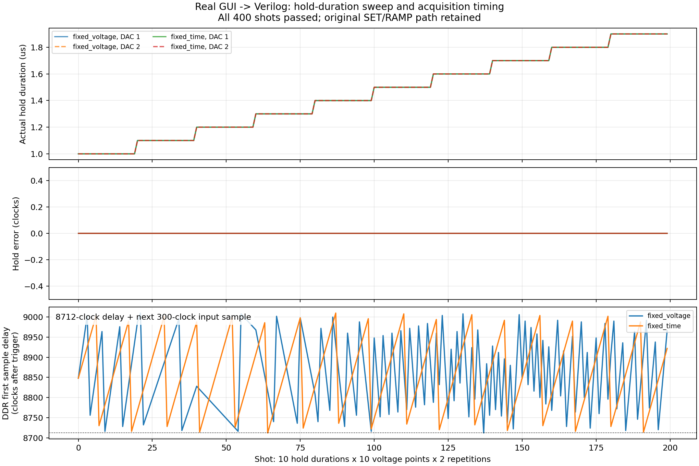

# AWG Tuning hold duration sweep: 실제 GUI → Verilog 검증

- 두 DC 모드 모두 실제 MainWindow 입력 → Run Experiment compiler → PMEM/DMEM → tProcessor/TMUX/AWG/RF/DDR RTL로 확인했습니다.
- 각 조건은 hold 1.0–1.9 µs(0.1 µs 간격 10값) × 전압 5–15 mV 10점 × 2회 = 200 shots입니다.
- 두 DAC의 cross-capacitance [[1,.23],[-.17,1]], DAC ±800/±400 mV, 48비트 DC 면적 누적을 사용했습니다.

| 조건 | 정책 | 실제 hold 오차 | 명령값/시각 오류 | 각 DAC 보상/초기화 | RF/DDR |
|---|---|---|---|---|---|
| 고정전압 20 mV | overlap_readout | 0 clocks | 0 / 0 | 200 / 200 | RF 200개·폭오차0, DDR 200 trigger·800 samples·400 writes |
| 고정시간 1 µs | after_readout | 0 clocks | 0 / 0 | 200 / 200 | RF 200개·폭오차0, DDR 200 trigger·800 samples·400 writes |

## 독립 확인
- 실제 rtl_events.csv에서 200개의 shot 경계를 추출했습니다. 각 채널의 SET→첫 RAMP 명령 간격은 293–563 clocks입니다.
- 기존 RAMP의 7-clock startup을 더한 실제 hold는 300–570 clocks(1.0–1.9 µs)이며 모든 점에서 요청값과 일치합니다. RAMP 출력 구간 시작 기준이며 양자화 때문에 첫 DAC 코드가 바뀌는 시각과는 구분합니다. 허용오차를 늘리지 않았습니다.
- command-to-raw-sample 독립 Verilog checker가 모든 clock × 16 DAC lanes를 검사합니다. 따라서 명령 시각만 확인한 결과가 아닙니다. IIR 정수 recurrence도 모든 샘플에서 독립 계산과 일치했습니다.
- 두 반복의 SET 값 동일, 각 hold 값에서 전압 고정 증분 동일, 다음 hold 값으로 갈 때 전압 축 rewind 동일을 실제 명령에서 확인했습니다.
- 보상 후 각 shot의 잔여/누적 면적은 정확히 0 effective-code samples입니다. 출력16/DC시작17 clocks, RF42 clocks 및 DDR8712 clocks+입력 sample 대기는 유지됩니다.

## 범위와 한계
- DDR 입력은 300 clocks마다 생성한 timestamp stream입니다. 실제 ADC/아날로그 측정이나 FIR 산술 정확도를 검증한 것은 아닙니다.
- 기존 정수 SET sweep의 이상 목표 전압 양자화 오차는 유지됩니다. 면적 잔여0은 실제 실행된 디지털 파형의 보상 결과입니다.
- 이번 시험은 hold_duration sweep 두 DC 모드입니다. 기존 RTL/XDC/펌웨어는 변경하지 않았고 합성 및 32/64비트 비교는 다시 실행하지 않았습니다.
- RTL/input snapshot SHA256와 각 GUI/RTL 원자료는 fixed_voltage 및 fixed_time 폴더에 보존했습니다. 최종 Acquisition-only GUI에서 두 조건을 다시 생성해 PMEM/DMEM 바이트 일치를 확인했고, 저장된 RTL evidence를 --analyze-only로 재검사했습니다. 시뮬레이터는 재실행하지 않았습니다.
- 이번 조건은 초기 runtime DMEM이 0 words입니다. sweep 상태의 memwi 초기화/증분/rewind는 PMEM 명령과 실제 RTL 동작 검증에 포함됩니다.
- 최종 GUI/compiler hash 및 이전/현재 PMEM/DMEM SHA256: [current_gui_replay/result.json](current_gui_replay/result.json).

[기계 판독 검증 결과](hold_rtl_verification.json)
