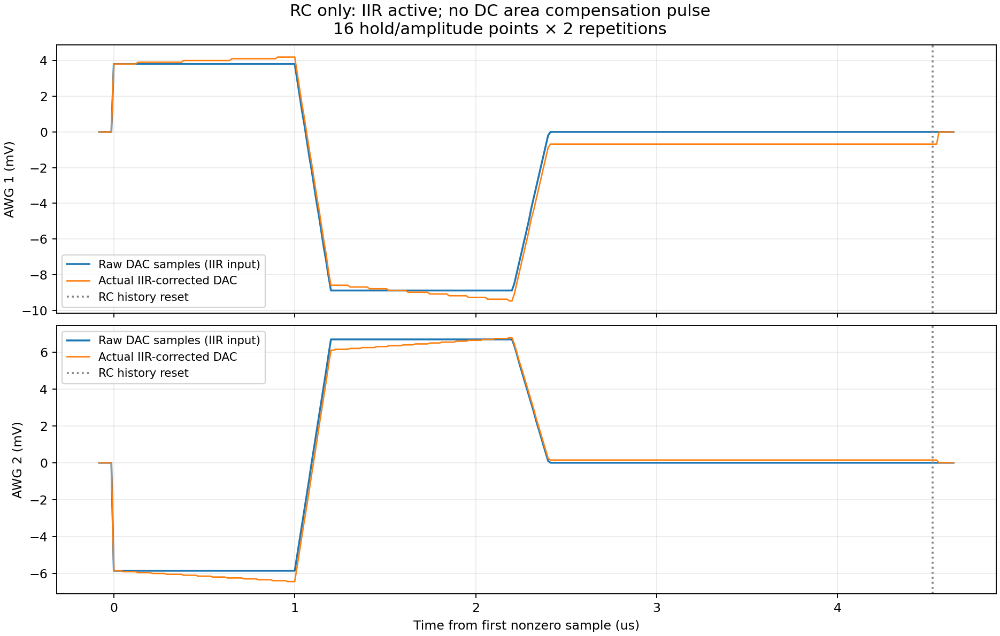

# RC만 활성화한 실제 GUI → Verilog 검증

GUI에서 **DC compensation 해제 / RC compensation 활성화**, τ=10 µs로 입력했습니다.
MainWindow의 실제 Run Experiment compiler 경로에서 얻은 PMEM/DMEM이 export 및 실제 RTL 입력과 바이트 단위로 일치합니다.
최종 GUI 소스로 다시 생성해 같은 PMEM/DMEM과 testbench fingerprint임을 확인했으며, 이 재확인에 xsim을 다시 실행하지 않았습니다.

- hold 1.0→1.9 µs × voltage 5→15 mV의 4×4=16점, 각 2회로 총32shots.
- 두 DAC와 cross-capacitance [[1,.23],[-.17,1]], DAC full scale ±800/±400 mV.
- DC 실행 명령 **0회**, 시작 때 이전 상태를 지우는 DC DISABLE만 채널별1회.
- 실제 RTL에서 면적 엔진은 disabled/idle이며, 모든 샘플이 5-clock pass-through와 일치합니다. DC 보상 출력·면적 누적·area completion은 없습니다.
- IIR은 활성화되었고 실제 DAC 출력이 raw 파형과 달라지는 샘플을 확인했습니다. 전체16lane의 독립 정수 IIR 재귀 비교 불일치는 **0**입니다.
- 채널별 RC reset33회(초기1+shot별32), 출력 및 IIR history zero 확인33회. 이는 shot 종료 zero/reset이며 별도 DC 보상 펄스가 아닙니다.
- 실제 tProcessor 명령값/시각 불일치0. RF32pulse 폭 불일치0; DDR monitor도 통과했습니다.

## 해석과 한계

RC 보정은 원래 파형에 IIR 적분항을 더합니다. raw 전압이0인 구간에서도 shot reset 전까지 DAC에 보정 offset이 남을 수 있으며, **이 offset은 DC 면적 보상 펄스가 아닙니다.** DC compensation을 끈 경우 shot의 면적을 반대로 상쇄하지 않으므로 실제 RC 커패시터 전하의0복귀를 보장하지 않습니다. 디지털 IIR history reset도 외부 커패시터를 초기화하지 않습니다.

이번 연속 RC 회로 모델의 목표 파형 대비 최대 오차는 AWG1 약3.454 mV, AWG2 약1.711 mV입니다. 이는 DC 면적 보상을 해제한 상태의 물리적 잔류를 포함한 값이며, DC+RC의 작은 종료 잔류 결과로 대체하거나0으로 주장하지 않습니다. 본 검증의0불일치는 디지털 IIR 재귀 및 명령 일치에 관한 수치입니다.

이번 결과는 실제 GUI 입력→tProcessor/TMUX/AWG/IIR Verilog 검증입니다. 실제 보드·아날로그 측정은 수행하지 않았으며, DDR 입력은 ADC/FIR 산술 대신 timestamp 스트림입니다.

[기계 판독 결과](verification.json) · [GUI 입력](gui_input.png) · [DC/RC 체크박스](gui_dc_controls.png)

