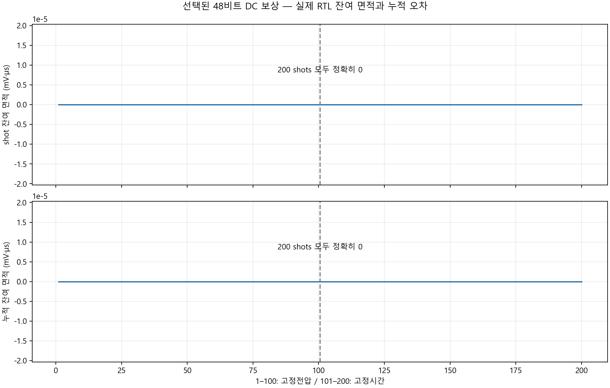
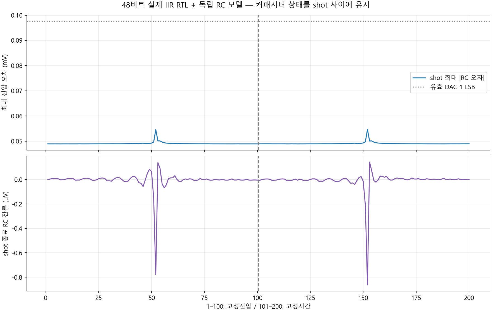

# 선택된 48비트 DC 보상 검증

현재 생산 RTL로 100점 전압 sweep × DC 2모드 = 200 shots를 완료했습니다.
32/64비트 폭 선택 비교는 다시 실행하지 않았습니다. 과거 비교와 그림은 ../width_comparison에 보존합니다.

- overflow 0, 완료 shots 200, 실제 샘플 면적 수집 오차 0.
- 모든 shot의 디지털 잔여 면적 0, 누적 잔여 면적 0.
- 독립 RC 모델 최대 전압 오차 0.05461681895 mV.
- shot 종료 RC 잔류 최대 0.000863350555 mV.
- 실제 입력: A 100µs (−614+12p), B 10µs (−205+4p), C 400µs (−1229+24p) effective DAC codes, p=0..99.
- 고정전압 200mV, 고정시간 200µs, ±800mV, 4.8GSPS, τ=300µs.
- RC 커패시터의 상태는 shot 사이에 유지됩니다. 디지털 면적과 RC 잔류 전압은 다른 지표입니다.
- 기존 정수 SET sweep의 이상 목표 전압 양자화 오차를 고친 시험이 아닙니다.
- GUI→RTL의 RF/DDR 정합, 실제 보드 측정, 전체 FPGA timing은 이 단독 시험과 별개입니다.

