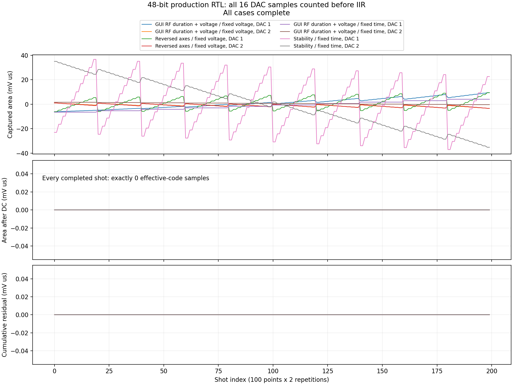
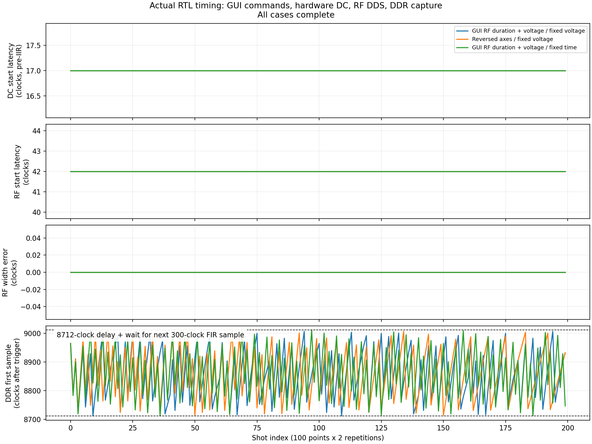

# GUI → 실제 RTL 검증

- 전체 완료: True
- 두 AWG의 기존 정수 고정 전압 증분/add/rewind를 그대로 사용했습니다.
- 보상 잔여 면적 0은 실행된 디지털 파형에 대한 결과입니다. 요청한 이상 전압과 SET sweep 누적 양자화 오차가 0이라는 의미가 아닙니다.
- GUI RF 시험: 실제 GUI MainWindow 설정을 읽는 Run Experiment 경로의 프로그램을 변경 없이 사용하고 exported PMEM/DMEM과 바이트 일치를 확인했습니다.
- Reversed axes 시험: GUI 값을 읽은 뒤 시험용으로 sweep 축 순서를 반전한 추가 compiler/RTL 스트레스 조건입니다. GUI를 변경 없이 실행한 조건과 구분합니다.
- RTL: 실제 tProcessor/TMUX/AWG/RF DDS 및 DDR capture IP. DDR 입력은 300클록마다 나오는 합성 timestamp stream이며 ADC/아날로그 실측 또는 FIR 산술 검증은 아닙니다.
- IIR 정수 recurrence는 전 클록/16 lanes에서 독립 계산과 일치해야 통과합니다. 아날로그 RC는 독립 수치 모델이며 capacitor state를 shot마다 강제로 초기화하지 않습니다.
- Stability 시험은 실제 Stability builder의 10×10 전압 grid, 역방향/축반전, 보상 및 반복을 검증했습니다. 해당 경우 자체에는 RF/DDR가 포함되지 않습니다.

| 조건 | 상태 | 명령/시각 불일치 | 각 DAC 보상/초기화 | RF 폭 오차 |
|---|---|---|---|---|
| GUI RF duration + voltage / fixed voltage | passed | 0 / 0 | 200 / 200 | 0 clocks |
| Reversed axes / fixed voltage | passed | 0 / 0 | 200 / 200 | 0 clocks |
| GUI RF duration + voltage / fixed time | passed | 0 / 0 | 200 / 200 | 0 clocks |
| Stability / fixed time | passed | 0 / 0 | 200 / 200 | 해당 없음 |

### GUI RF duration + voltage / fixed voltage
- DDR: FIR_DC_CAPTURE_RESULT triggers=200 samples=800 AXI_writes=400 delay_cycles=8712
- RF 명령→실제 출력 지연: 42 clocks (기존 RF 경로)
- 새 AWG 파이프라인 5클록은 GUI의 AWG segment/RF/DDR trigger 기준에 함께 반영됩니다. 설정된 DDR 8,712클록 지연 자체는 바뀌지 않습니다.
- DAC 1: 독립 RC 모델 최대 오차 0.061709424 mV (한 effective DAC LSB 0.097656250 mV).
- DAC 2: 독립 RC 모델 최대 오차 0.029427185 mV (한 effective DAC LSB 0.048828125 mV).

### Reversed axes / fixed voltage
- DDR: FIR_DC_CAPTURE_RESULT triggers=200 samples=800 AXI_writes=400 delay_cycles=8712
- RF 명령→실제 출력 지연: 42 clocks (기존 RF 경로)
- 새 AWG 파이프라인 5클록은 GUI의 AWG segment/RF/DDR trigger 기준에 함께 반영됩니다. 설정된 DDR 8,712클록 지연 자체는 바뀌지 않습니다.
- DAC 1: 독립 RC 모델 최대 오차 0.059391602 mV (한 effective DAC LSB 0.097656250 mV).
- DAC 2: 독립 RC 모델 최대 오차 0.029074451 mV (한 effective DAC LSB 0.048828125 mV).

### GUI RF duration + voltage / fixed time
- DDR: FIR_DC_CAPTURE_RESULT triggers=200 samples=800 AXI_writes=400 delay_cycles=8712
- RF 명령→실제 출력 지연: 42 clocks (기존 RF 경로)
- 새 AWG 파이프라인 5클록은 GUI의 AWG segment/RF/DDR trigger 기준에 함께 반영됩니다. 설정된 DDR 8,712클록 지연 자체는 바뀌지 않습니다.
- DAC 1: 독립 RC 모델 최대 오차 0.068002466 mV (한 effective DAC LSB 0.097656250 mV).
- DAC 2: 독립 RC 모델 최대 오차 0.033597107 mV (한 effective DAC LSB 0.048828125 mV).

전체 FPGA setup/hold closure와 BIT/HWH 배포 여부는 별도 최종 빌드 보고서를 확인해야 합니다. 이 RTL 보고서만으로 펌웨어 배포 완료를 의미하지 않습니다.
