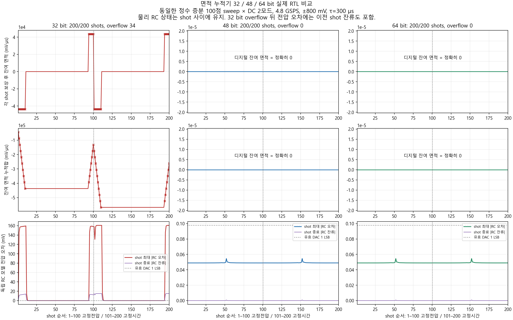
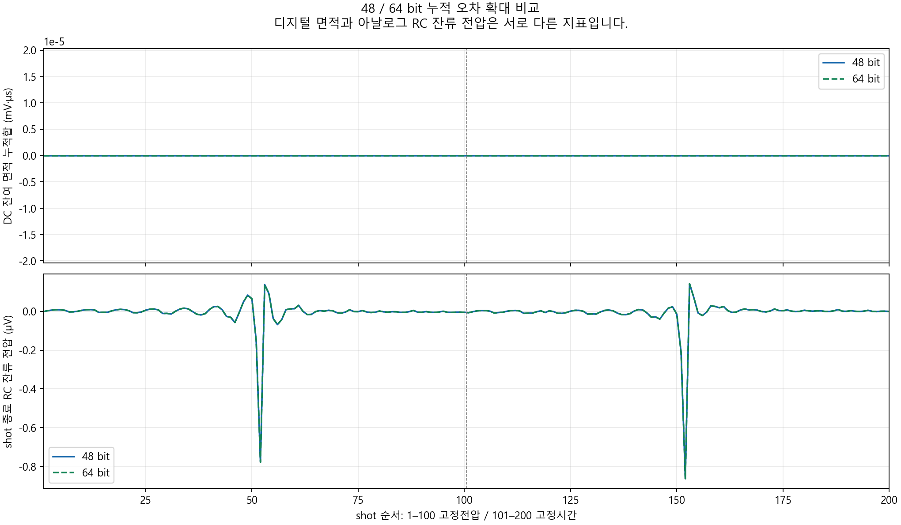

# 32/48/64-bit 누적 오차 비교

**전체 600 shots의 RTL 비교 완료.**

각 폭에서 동일한 100점 전압 sweep을 고정전압/고정시간 보상으로 실행합니다. 총 200 shots/폭입니다.
원하는 SET sweep 전압의 반올림 방식을 바꾸지 않고, 실제 IIR 입력 샘플의 면적을 합산한 보상 결과입니다.

| 폭 | 완료 shots | overflow | 최대 shot 잔여 면적 (code·sample) | 최대 누적 잔여 면적 (code·sample) | 최대 RC 오차 (mV) |
|---|---:|---:|---:|---:|---:|
| 32 | 200/200 | 34 | 2147502160 | 27917391632 | 160.649502 |
| 48 | 200/200 | 0 | 0 | 0 | 0.0546168189 |
| 64 | 200/200 | 0 | 0 | 0 | 0.0546168189 |

48/64-bit 공통 200 shots의 모든 수치 열(폭 식별자 제외) 동일 여부: **True**.

## 동일 입력 조건

p=0..99이며, 아래 코드는 effective DAC code입니다. 1 code = 800/8192 mV입니다.

| 구간 | 시간 | 각 지점의 실제 입력 코드 |
|---|---:|---|
| A | 100 µs | −614 + 12p |
| B | 10 µs | −205 + 4p |
| C | 400 µs | −1229 + 24p |

고정전압 보상 크기는 200 mV(2048 code), 고정시간 보상은 200 µs(60,000 fabric clocks)입니다. 보상 부호는 IP가 누적 면적에서 결정합니다.
위 정수 코드열 자체에 대한 면적 정확도 시험이며, 임의의 사용자 시작/끝 전압을 정확한 linspace로 만드는 시험이 아닙니다. 기존 SET sweep 증분의 양자화 정책은 별개로 유지됩니다.

## 해석과 검증 범위

- 32-bit의 overflow는 성공한 DC 보상이 아닙니다. 테스트벤치가 예상한 overflow 검출 자체에 PASS를 출력하더라도, 해당 입력 범위에서 사용 가능하다는 의미가 아닙니다.
- overflow가 없다면 면적은 유효 DAC 코드의 정수 합이므로 별도의 소수 비트 반올림 오차가 없습니다. 48/64 bit 차이는 우선 누적 가능한 범위입니다.
- 그림의 누적 오차는 실제 출력 잔여 면적의 signed 합입니다. 각 shot 오차도 별도 표시하므로 양/음 오차 상쇄로 실패를 숨기지 않습니다.
- RC 모델은 모든 DAC scalar sample을 처리하고 물리 커패시터 상태를 shot 사이에 초기화하지 않습니다. 따라서 32-bit overflow 이후의 정상 범위 shot에도 아날로그 잔류가 전달됩니다.
- τ=300 µs 단일 pole 회로 모델이며 실제 보드의 측정 오차를 보장하지 않습니다. IIR Q48/72-bit와 reciprocal Q64는 세 폭 모두 동일합니다.
- 이번 그림은 실제 면적 엔진과 기존 IIR RTL을 사용한 폭 비교입니다. 전체 tProcessor/RF/DDR 시간 정렬, Vivado timing closure 및 bitstream 검증은 후속 검증 대상입니다.

