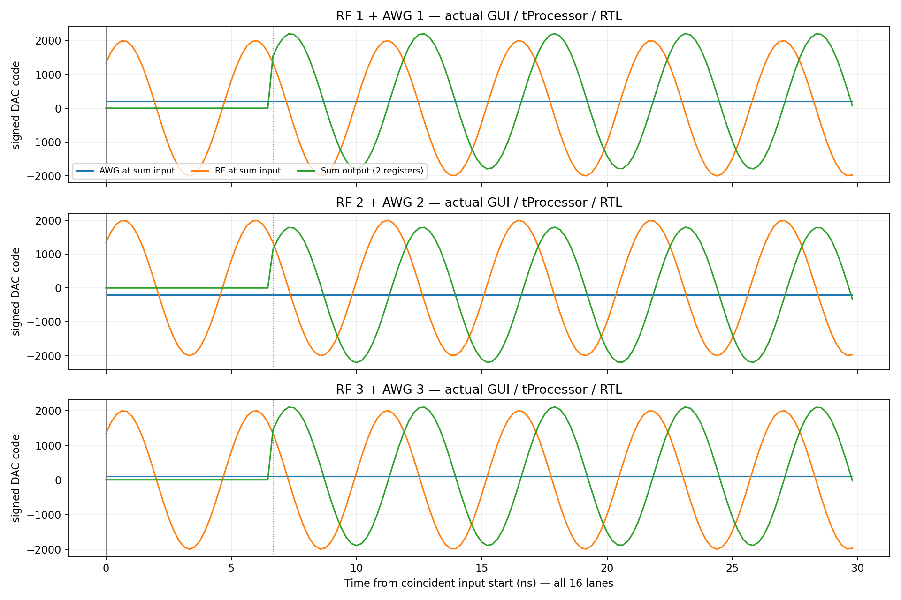

# AWG Tuning v4 — 최종 검증 보고서

## GUI 업데이트 기능 — 구현 완료, 실행 검증 미수행

전체 기본 회귀 PASS를 먼저 확정하고 174개 소스/설정/펌웨어와 결과를 스냅샷으로 보존한 뒤 기존 GUI `awg_tuning_v4`에 구현했습니다.
메뉴는 `Setup → QICK Library and Firmware Update...`입니다. 로컬 저장소/성공 v4 manifest 선택, SSH 보드 폴더 탐색, 원본→대상 표시, 전송 전 해시 검사, 별도 staging, 백업/복원 및 재시작 후 펌웨어 식별 동작을 코드로 추가했습니다.
보드 기본 위치는 `/home/QSTL_QICK`; 라이브러리는 `qick/qick_lib`, BIT/HWH는 `qick/firmware` 아래에서 선택합니다. QICK 정지·재시작은 사용자가 수동으로 수행하며 이 기능이 서버를 자동 재시작하거나 파형을 실행하지 않습니다.

**사용자 지시대로 새 GUI·신규 테스트·업데이터·SSH 전송/교체·패키지 설치는 실행하지 않았습니다.** 정적 코드 검토와 diff 확인만 했습니다. Paramiko는 선택 의존성 파일에만 추가했습니다. 실제 사용 전 실행 검증이 남아 있으며 이 기능을 기존 회귀 PASS에 포함하지 않습니다.
기존 생산 파일 변경은 GUI 메뉴/진입점의 `DCWaveform_Generator.py` 1개이며 나머지는 새 유지보수 모듈/설명서입니다. 기존 RTL/드라이버/XDC/펌웨어/사용자 JSON과 보호 59파일은 변함없습니다.
[구현 소스 해시 및 미실행 기록](gui_update_implementation.json), [GUI 사용법·남은 검증](../../../PulseGenerator/DCWaveformGeneratorGUI/QICK_UPDATE.md).

## 2026-10-14 09:05 PDT — 현재 v4 전체 기본 회귀 재실행 완료

**현재 v4로 새로 실행한 전체 기본 회귀가 PASS입니다.** [통합 결과](full_regression_20261014/results.json)의 `complete=true`와 [보고서](full_regression_20261014/REPORT.md)를 확인했습니다. controller와 xsimk는 모두 종료했습니다.

- 소프트웨어 72모듈 1,194개 + 추가 29개 = **1,223개 PASS**.
- 기본 RTL 6묶음 및 합산 단위 **1,114,160샘플 PASS**.
- 시스템 **9/9조건 PASS**: 두 HOLD sweep, RF duration 2조건, RC-only, 축 반전, Stability, 10µs RAMP/HOLD의 첫/둘째 HOLD RF.
- 8조건은 실제 MainWindow → Run Experiment → PMEM/DMEM 바이트 일치 → 실제 RTL입니다. Stability는 GUI public builder → 실제 RTL이며 RF/DDR가 없는 기존 기본 조건입니다.
- 48비트 연속 RC **200/200 PASS**, overflow·잔여·누적 면적 0. 최대 RC 오차 0.05461681895mV, 종료 잔류 최대 0.000863350555mV.
- 최초 Qt 종료 오류 2건과 desktop bootstrap 누락 1건은 원본을 보존했습니다. 동일 검사의 환경 처리 후 재실행은 모두 exit 0입니다. controller의 `finished_with_failures`/exit 1은 이 최초 3건을 보존한 값이며 새 stage/case 실패는 없습니다. 재실행 해시/로그를 대조한 통합 결과로 PASS를 판정했습니다.
- 검증 시 생산 소스·사용자 JSON·펌웨어 해시 변경 0, 보호 59파일 일치. 새 합성/배포/32·64비트 비교는 없습니다.

[검증 당시 174개 파일과 결과 스냅샷](full_regression_20261014/validated_snapshot/manifest.json)을 보존했습니다. 이후 GUI 유지보수 기능 추가는 이 PASS에 포함되지 않으며 실행 검증 전입니다. `report.py`를 수정된 트리에 다시 실행하여 이 완료 증거를 덮어쓰지 않습니다.
[누적 면적 그림](full_regression_20261014/selected48/accumulated_error_48.png)과 [RC 오차 그림](full_regression_20261014/selected48/rc_error_48.png)을 열어 확인했습니다.
보드 아날로그 측정/ADC·FIR 산술은 미수행이고, IIR 뒤 DDS 면적·clipping은 기존 DC 면적 보상 대상이 아닙니다.

전체 기능 검증과 routed timing closure 및 펌웨어 배포가 완료됐습니다.
아래 기능 검증은 빌드 시점 소스로 수행했고, 빌드 후 GUI/드라이버 연동 결과와
최종 timing 수치는 문서 하단에 기록했습니다. 실제 보드 아날로그 측정은 수행하지 않았습니다.

| GUI / RTL case | Points x repetitions | RF/AWG pairs | Requested RF offset (cycles) | Start / width mismatches | Command value / timing mismatches |
|---|---:|---:|---:|---:|---:|
| hold_fixed_time | 100 x 2 | 3 | [0] | 0 / 0 | 0 / 0 |
| hold_fixed_voltage_offset | 100 x 2 | 3 | [30] | 0 / 0 | 0 / 0 |
| rf_duration_extend | 4 x 2 | 3 | [0] | 0 / 0 | 0 / 0 |
| rf_duration_fixed | 4 x 2 | 3 | [30] | 0 / 0 | 0 / 0 |
| rc_only | 16 x 2 | 3 | [0] | 0 / 0 | 0 / 0 |

Each case used actual MainWindow -> Run Experiment compilation; PMEM and
DMEM matched the Verilog input byte-for-byte. Every sum lane was checked
against an independent signed-add/saturate/round reference. The DC-enabled
cases checked all three pre-IIR area engines and reset after each shot,
with zero residual integer area. RC-only cases required zero DC commands.

DDR capture used a timestamp stream to check trigger/data alignment:
four samples and two AXI writes per shot, with the existing 8712-cycle
delay. It does not test ADC analog conversion or FIR numeric response.

The sum and bypass unit test checked 1,114,160 samples, including 149,495
positive clips, 83,952 negative clips and 549,930 rounding checks.
Related GUI/library software tests: 234 passed. Protected v3 source
and constraint hashes: 59 files unchanged. The accumulator remains 48 bits.

The added sum/bypass delay is two 300 MHz clocks. Measured RF and AWG
generator path difference is 13 clocks; v4 scheduling compensates it.
Final physical output path latencies are AWG 31 / RF 44 clocks from the
tProcessor event, including the common routing and output slice. The
`rf_measurements.latency_cycles=42` field refers to the old RF slice
retained only as a diagnostic in the focused testbench. It is not the
new summed physical output. In production the former RF DAC ports are zero.

The sum follows the existing AWG IIR. AWG DC compensation does not cancel
added DDS area or final clipping distortion. RF gain uses raw DDS codes;
calibration of the old dedicated RF connector cannot be reused. Existing
integer SET sweep quantization and analog bandwidth remain unchanged.

Evidence is in `system_validation/`, `system_summary.json`, `unit/`,
`software_final.xml`, and `prebuild_gate.json`. The gate binds source and
evidence hashes and is rechecked before full synthesis and publication.

## 최종 완료 — 2026-10-14

전체 합성·배치·배선, 펌웨어 파일 배포, GUI/Python 드라이버 연동 검증을 완료했습니다.
두 저장소 모두 기존 `awg_tuning_v4` 브랜치이며 commit/push는 하지 않았습니다.
실제 보드 다운로드 또는 아날로그 측정은 수행하지 않았습니다.

| 최종 routed 검사 | 결과 |
|---|---:|
| Setup WNS / TNS | +0.002841 ns / 0 ns |
| Hold WHS / THS | +0.009116 ns / 0 ns |
| Pulse-width 실패 endpoint | 0 |
| Bus skew | 14/14 MET, 최소 +2.201 ns |
| 배선 | 579,977/579,977 nets, 오류 0 |

Vivado 2023.1, jobs=4, general.maxThreads=5, 기존 default 전략을 유지했습니다.
원래 v3 timing.xdc/ios.xdc와 59개 보호 파일의 해시가 일치합니다.
기존 XDC의 input-delay 미지정 4개/output-delay 미지정 24개와 methodology 경고는
보고서에 그대로 남아 있습니다. 제약 완화 없이 명시된 timing 제약을 통과했습니다.
Setup 여유는 약 2.841 ps이므로 큰 여유가 있는 결과로 해석하지 않습니다.

`F:/Vivado_Output/a4full2`는 Git 밖의 새 프로젝트입니다.
10월 13일 19:47:43 시작, 10월 14일 00:27:27 Vivado 종료,
00:28:12 기존 workflow의 펌웨어 배포 완료입니다(약 4시간 40분).
`workflow_status.json`은 `complete=true`, `stage=published`, `exit_code=0`입니다.
BIT/HWH/XSA는 같은 성공 XSA에서 추출됐고 SHA256 및 내부 멤버 바이트 일치를 확인했습니다.

### 최종 GUI / Python 연동

| RF / AWG | QICK generator | RFDC DAC ID | GUI 물리 커넥터 |
|---|---|---|---|
| RF 1 + AWG 1 | 0 + 1 | 10 | DAC4 |
| RF 2 + AWG 2 | 2 + 3 | 11 | DAC5 |
| RF 3 + AWG 3 | 4 + 5 | 12 | DAC6 |

HWH를 실제 QICK metadata parser와 generator connection method로 읽어 세 합산 쌍,
나머지 AWG 4개의 동일 지연, RF 4/Square의 기존 경로를 확인했습니다.
AWG/RF metadata 지연은 각각 18/31클록, 공통 경로 포함 물리 출력 지연은 31/44클록입니다.
RF 명령을 13클록 앞당겨 요청한 출력 시각을 맞춥니다.

빌드 후에는 필요한 두 소프트웨어 파일만 추가 수정했습니다.
- GUI `qick_front_panel.py`: v4 합산 커넥터와 두 generator를 표시하고, 비활성 ATT의
  기본 10 dB가 설정에 섞이지 않도록 ATT=0 / filter=bypass / NQZ=1을 적용합니다.
- Python `qick/dac_current.py`: 실제 HWH 메타데이터로 서로 연결된 AWG/RF 합산 쌍만
  AWG 물리 DAC로 판별합니다. 두 generator가 같은 전류 readback/전압 환산을 사용하며,
  전류 변경은 물리 DAC에 한 번 적용됩니다. 기존 RF와 불완전한 합산 메타데이터는
  기존 읽기 전용 동작을 유지합니다. 기존 VOP/전류 범위 검사는 유지합니다.

최초 확대 검사에서 위 두 문제를 세 쌍 모두 재현했고 `postpublish_before_fix.log`에
보존했습니다. 수정 후 관련 소프트웨어/GUI/최종 HWH 연동 검사 **274개 PASS**입니다.
최초 테스트 fixture의 calibration DB 경로 누락으로 발생한 3개 실패도 별도 보존했으며,
제품 코드 문제와 구분합니다(`final_integration_fixture_failure.*`).

다섯 조건을 수정된 실제 MainWindow -> Run Experiment 경로로 다시 컴파일하여
PMEM/DMEM이 이전 완료 RTL 입력과 모두 바이트 일치하는 것을 확인했습니다.
RTL·제약·펌웨어·프로그램 생성 로직은 빌드 후 변경하지 않았고 장시간 시뮬레이션이나
합성을 다시 수행하지 않았습니다. 새 검사는 테스트용 RFDC/카드 정보를 사용하며
보드 아날로그 측정 결과가 아닙니다.

빌드 시점의 `prebuild_gate.json`과 `build_manifest.json`은 변경하지 않았습니다.
그 원본 gate는 빌드 당시 소스를 증명합니다. 이후 두 소프트웨어 변경의 현재 해시,
원본 스냅샷, 274개 검사 및 5개 GUI 프로그램 일치는
`final_integration_manifest.json`과 `postpublish_program_equivalence.json`으로 연결했습니다.
현재 트리에 원래 `validate_scope.py --require-functional`을 단독 실행하면 이 두 변경을
검출하는 것이 정상이며, 이를 우회하도록 원래 gate를 바꾸지 않았습니다.
현재 최종 연동 증거는 `python analysis_results/awg_tuning_v4/finalize_integration.py`로
검증합니다. 향후 다른 소스 수정/새 합성에는 새로운 기능 증거가 필요합니다.

### 파일 / 사용 범위

펌웨어는 `C:/GIT_Workspace/QSTL_QICK/qick/firmware/projects/qstl_awg_v4/`의
`bitstream.bit`, `bitstream.hwh`, `bitstream.xsa`입니다. BIT와 HWH는 같은 v4 쌍으로
사용해야 합니다. 기존 v3 펌웨어는 보존했습니다. 보드 Python 라이브러리와 PC GUI는
각 저장소의 `awg_tuning_v4` 코드를 함께 사용합니다.

- 파형: `rtl_sum_alignment.png` (16 scalar lanes 전체)
- GUI 확인: `final_gui_shared_dac.png` (최종 HWH 경로, 테스트용 카드 정보)
- 상세 timing: 프로젝트 `validation_reports/`
- 소프트웨어 검사: `postpublish_software.xml`, `postpublish_software.log`
- 실제 GUI 재컴파일: `compiler_replay/`, `postpublish_program_equivalence.json`
- 최종 증거 연결: `final_integration_manifest.json`

AWG DC 면적 보상은 IIR 이전 AWG 면적만 보상합니다. 이후 더해지는 DDS 면적과
최종 clipping 왜곡은 보상하지 않습니다. 기존 정수 SET sweep 양자화는 그대로입니다.
DDR 검증은 timestamp 스트림의 명령/trigger/capture 정합이며 ADC/FIR의 아날로그 또는
수치 응답 검증이 아닙니다. 최종 완료 확인 후 `awg-v4-timing` 자동화를 PAUSED로 전환했습니다. 기존 `awg-v3`도 PAUSED를 유지합니다.
