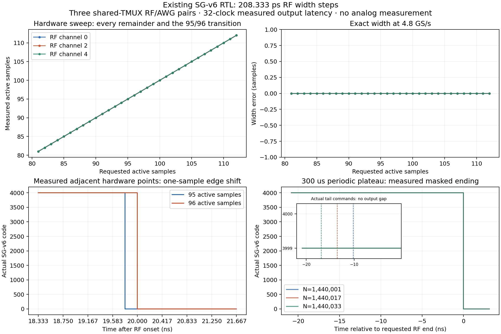
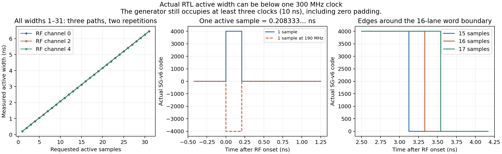

# Actual SG-v6 sample-width RTL verification

The inputs passed through the staged GUI, normal experiment arguments, and real QICK compiler. Actual tProc PMEM/DMEM drives the unchanged shared-TMUX SG-v6/AWG paths. The testbench loads IQ samples through host AXI configuration and the actual AXIS data_writer/BRAM. Vendor DDS logic and the v4 output-sum RTL are included.

- Every active width from 81 through 112 samples: exact on all three RF paths, twice per point.
- Every active width from 1 through 31 samples: exact on all three RF paths, twice per width (186 bursts).
- At 190 MHz and 37 degrees, all 1–31-sample bursts match an actual 4801-sample reference carrier extrapolated at the exact FTW and absolute sample time (186 additional bursts).
- Hardware duration × frequency sweep: 32 × 2 points, with 0 MHz exact sample counts and 190 MHz carrier fits.
- Requested frequency and phase words independently checked against the user coordinates.
- Short pulses, negative gain, gain 16383, 10 us/100 us fractional endings, and all three periodic-boundary classes checked.
- All command values/timestamps and all sum lanes checked; no unexpected nonzero sample outside requested windows.

The duration step is 1/4.8 ns = 0.208333… ns. Onset timing remains on the existing 300 MHz grid. The masked product path uses doubled gain and limits the requested gain magnitude to 16383; its integer multiplication can differ from the DDS plateau by a few DAC codes. The measured command-to-sum-input latency is 32 fabric clocks; this result does not claim a v5 latency change, routed timing signoff, or measured analog rise/fall time.
