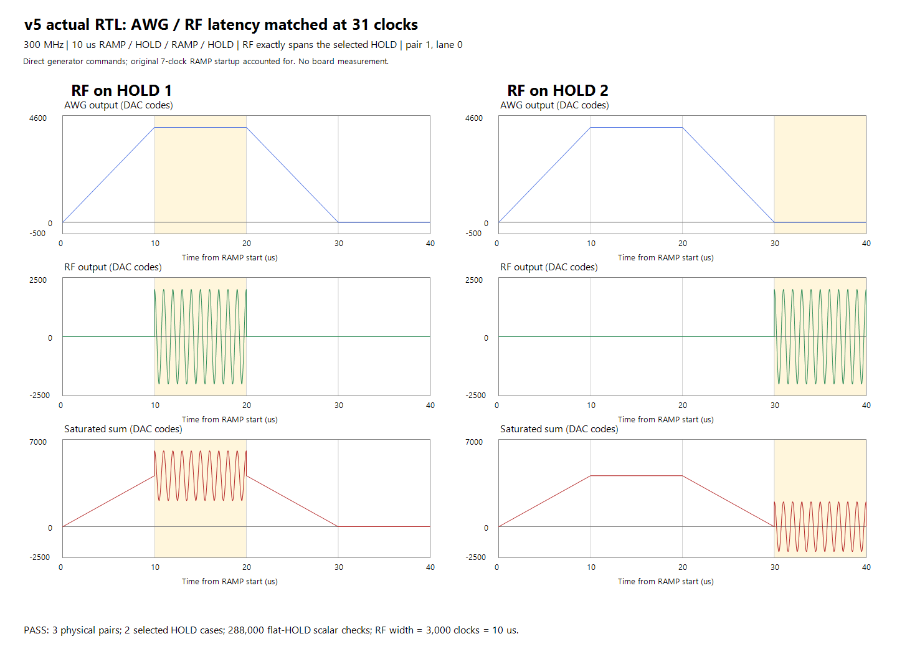

# v5 progress — validation and build are not yet complete

2026-10-14 19:55 America/Vancouver. Latest execution state is in
`workflow_status.json`, `replays_status.json` and `selected48_status.json`.

## Authorized Python correction

The AWG output editor previously offered the RF generator on a shared physical
DAC. Selecting DAC5 could therefore submit generator 2 and fail AWG validation.
`qick_front_panel.py` now filters by AWG generator identity and selects generator
3 on DAC5. DAC4/5/6, stale preferred selection, legacy metadata, Stability and
returning to RF mode are covered. The five related test modules passed all 73
checks. Restarting the desktop GUI is needed to load this code; no running GUI,
QICK server or board was restarted by this task.

## Current fresh validation

| Check | Result | Evidence |
|---|---|---|
| GUI output selector | 73 PASS | gui_selection_tests.xml |
| Basic software | 74 modules, 1,249 tests PASS after reviewed retries | a5reg1/status.json, desktop_retries.json |
| Basic selected-48 RTL | All six suites PASS | F:/Vivado_Output/a5reg1 |
| New sum/bypass/reset/valid/clipping | 1,115,040 samples PASS | F:/Vivado_Output/a5sum2 |
| Actual AWG + vendor DDS native latency | 96 checks PASS; both 31 clocks after sum | F:/Vivado_Output/a5native3/native_latency.csv |
| Native 10 us RAMP/HOLD/RAMP/HOLD | Three pairs, first/second HOLD RF, 288,000 flat-HOLD checks PASS | F:/Vivado_Output/a5ramp2 |
| Current compiler input equivalence | 9/9 PMEM/DMEM byte-identical | compiler_equivalence.json |
| System RTL replay | 5/9 PASS; 2 running, 2 queued | replays_status.json |
| Continuous 48-bit RC | 200-shot run in progress | selected48_status.json |
| Routed report gate | 9/9 parser acceptance/rejection tests PASS; not v5 timing signoff | routed_gate_tests.json |
| Full v5 synthesis/implementation | Not started; waits for required functional gates | workflow_status.json |

The GUI 73 tests overlap the basic regression and are not 73 unique extra tests.
The basic run retains three initial desktop-environment failures: RC and phase
tests passed assertions but hit Qt shutdown access violations; trigger-panel
lacked the existing desktop simulation bootstrap. The unchanged assertions
passed with explicit teardown/bootstrap, with exit codes and hashes recorded.
Initial native testbench counting/window/RAMP-startup mistakes and replay setup
failure are retained separately; no production RTL was changed to mask them.

The nine system inputs were freshly compiled with current software; eight
include actual MainWindow compilation. Stability uses its public builder and
has no RF/DDR. The original axis-reversal fixture changes sweep order after GUI
input. Fresh v5 simulations use these byte-identical inputs. The existing v4 RF
advance remains in Python, so this is not a v5 GUI timing compatibility claim.

## Scope and remaining build

Both repositories remain on `awg_tuning_v4`; the new project is `qstl_awg_v5`.
Native AWG latency is 16 + 13 + 2 clocks and RF is 29 + 2 clocks. All seven
AWGs, including four bypass outputs, receive the same new AWG delay. Different
command arrival times and the original seven-clock RAMP startup are preserved.

Existing generator/controller/IIR/DC/RF/tProcessor/TMUX/Square/DDR and XDC are
unchanged. Scope checks protect 253 baseline files with only the specifically
authorized GUI selector exception. User settings and existing v4 firmware are
preserved. No board actions, branch creation, commit or push were performed.

After all required tests pass, the existing controller builds fresh
`F:/Vivado_Output/a5full1`: Vivado 2023.1, jobs=4, general.maxThreads=5, default
strategies and byte-identical XDC. Final routed setup/hold/pulse-width/bus-skew
failure stops before bitstream generation, without repair or retry. A successful
candidate stays outside Git and is not deployed or substituted for v4 firmware.

Actual board analog behavior and ADC/FIR arithmetic were not measured. Existing
DC compensation covers AWG area before IIR; added DDS area and clipping are
outside that compensation scope. Final timing is not yet known.

## Later instruction: scheduled review and software integration

At 2026-10-14 20:03 America/Vancouver the user requested result reviews starting
three hours later, then every ten minutes, and Python/GUI changes after verified
build success. The existing heartbeat now starts at 23:02:58 local. Existing
controllers continue; this schedule update is not a new build result.
Postbuild support and verification are planned in `SOFTWARE_FOLLOWUP.md`.
The current v4 timing profile must not be treated as completed v5 GUI support.

## Additional requested plot/editor fixes

Stale AWG annotation and interrupted HOLD voltage dragging are corrected;
RF pulse names now appear inside their envelopes. The dedicated affected suite
passed 79 tests with no Qt callback errors, and all nine current compiler inputs
remain identical. See [the display-fix report](plot_annotation_fix/REPORT.md).
The broader GUI run surfaced a separate duration-parameter rename callback
exception (`KeyError: d1`) despite 157 passing assertions; it is not a clean pass
and remains documented separately. RTL, compiler/driver timing, firmware and
the user's running GUI/board were not changed by this display task.
