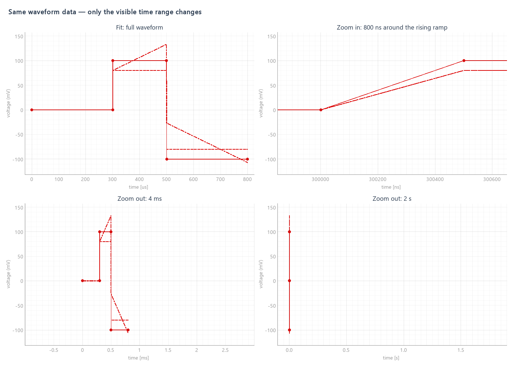

# Waveform Plot 시간 단위 자동 전환

2026-10-06, GUI `awg_tuning_v3`의 `c9af365`에 적용했다. `awg_tuning_v2` 기반에서 아래 검증을 통과한 동일 구현을 사용자 요청에 따라 v3로 옮겼다. 기존 v2 브랜치는 변경하지 않았다.

보이는 x축 범위의 폭에 따라 `ns / us / ms / s`를 선택한다. 축 제목과 눈금 숫자를 함께 변경하며, 절대 시간 위치 대신 범위의 폭으로 판단하므로 긴 파형의 뒤쪽에서도 ns 단위로 확대할 수 있다. 입력칸의 시간 단위 선택은 그대로 유지한다.

큰 절대 시간에서 서로 다른 눈금이 같은 `1e+09`로 표시되던 기본 포맷 문제도 수정했다. 시간축의 숫자 정밀도는 현재 눈금 간격으로 결정한다. 모든 파형 및 편집 좌표는 기존 ns 단위를 유지한다.

## 검증

- 다음 4개 모듈 총 **125개 통과**, pytest 프로세스 **exit=0**, 98.22초.
  - `test_waveform_compensation_display.py`
  - `test_dc_waveform_gui_rf.py`
  - `test_trace_plot_overlay.py`
  - `test_gui_shutdown.py`
- `ns/us/ms/s` 눈금 숫자·축 제목 일치, 늦은 시간 구간의 눈금 중복 없음, Fit 복귀, 단위 경계 양방향 전환, pan 및 y축 범위 변경을 검사했다.
- Virtual / Physical / RC compensation / sweep 곡선 배열, 원래 pulse 시간, preview sequence 및 snapping 유지와 입력 단위 변경을 검사했다.
- 실제 Qt 휠 이벤트로 `us → ns → us` 전환 후 Fit 복귀를 확인했다. 동일한 파형을 네 범위로 표시한 실제 QWidget 렌더링을 열어 확인했다. [휠 이벤트 기록](zoom_checks.json), [재현 스크립트](render_check.py).
- 환경: Windows, qcodes2 Python 3.12.5, `QT_QPA_PLATFORM=offscreen`. 테스트용 pytest는 별도 임시 폴더에 설치했다. 실제 보드에 연결한 측정이나 RTL 실행은 하지 않았으며 FPGA/출력 명령 생성 코드는 변경하지 않았다.

GUI 저장소 루트에서 실행한 검사:

```text
python -m pytest DCWaveformGeneratorGUI/test_waveform_compensation_display.py DCWaveformGeneratorGUI/test_dc_waveform_gui_rf.py DCWaveformGeneratorGUI/test_trace_plot_overlay.py DCWaveformGeneratorGUI/test_gui_shutdown.py -q
```


